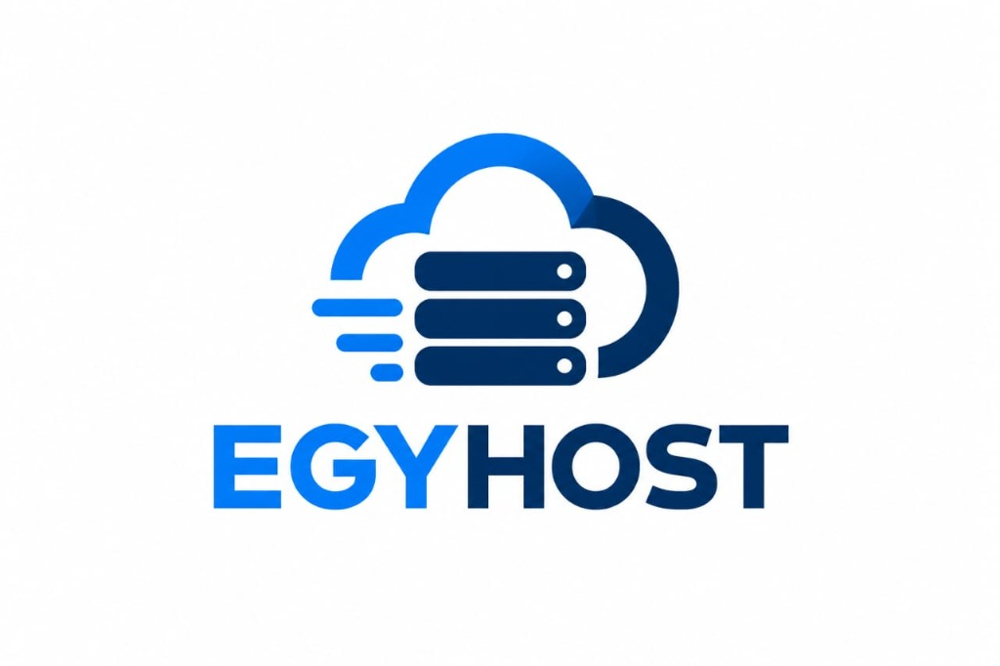

# EGYHOST — سحابة سيرفرات VPS واستضافة n8n للأتمتة والذكاء الاصطناعي
### High-Performance Cloud VPS & Managed n8n Automation Hosting Platform



منصة سحابية متطورة مصممة وفق نظام التصميم **Cloud Core Precision**، متخصصة في بيع وتجهيز سيرفرات الـ VPS عالية الأداء واستضافة بيئات أتمتة **n8n** بدون قيود على عدد التشغيلات، مع دعم كامل لوسائل الدفع المحلية في مصر (إنستاباي، فودافون كاش، فوري).

---

## 🏢 بيانات الشركة الرسمية

- **الاسم التجاري:** EGYHOST
- **صفة الشركة:** شركة مصرية مسجلة ومرخصة
- **رقم التسجيل الضريبي:** `778319636`
- **ضمان الخدمة:** ضمان استرداد الأموال خلال 30 يومًا للخدمات المؤهلة
- **بوابة الربط المباشر:** نقطة تبادل الإنترنت في مصر (EG-IX) بزمن استجابة أقل من 8ms

---

## ⚡ مميزات الفرونت إند (Frontend Features - Ready & Complete)

- **نظام التصميم Cloud Core Precision**: واجهة هندسية فائقة الدقة بتدرجات الكحلي المؤسسي (`#00173e`) والسايان الكهربائي (`#00D8FF`) والأسطح الجليدية الباردة (`#F8FAFC`).
- **صفحة من نحن الرسمية ([`about.html`](about.html))**: استعراض متكامل لبيانات الشركة المرخصة (778319636)، خدمات الاستضافة الست، ميزات المنصة، وضمان الـ 30 يوماً.
- **صفحة سياسة الخصوصية ([`privacy.html`](privacy.html))**: وثيقة قانونية معتمدة تغطي البنود الـ 12 لحماية البيانات وحقوق المستخدمين.
- **محاكي خط التجهيز الآلي (Provisioning Pipeline Simulator)**: محاكاة تفاعلية بـ 5 مراحل لعزل الموارد، تشغيل حاويات n8n، ضبط Reverse Proxy، إصدار SSL التلقائي، وربط قواعد البيانات مع بث مباشر لمخرجات الـ Terminal.
- **حاسبة الموارد المخصصة (Custom Plan Builder)**: أشرطة سحب وتمرير ديناميكية لحساب المعالج (vCPU)، الذاكرة (RAM)، وتخزين (NVMe Gen4) مع تحويل فوري بين الجنيه المصري (EGP) والدولار (USD).
- **جدول مواصفات الحزمة البرمجية (Server Stack Table)**: استعراض تفصيلي لإصدارات Ubuntu 24.04 LTS، n8n v1.65+، Docker 27.2، PostgreSQL 16، و Redis 7.2.
- **الطرفية التفاعلية (Interactive Code Terminal)**: قوالب جاهزة للنسخ بنقرة واحدة لملف `docker-compose.yml`، أوامر فحص الأداء `YABS`، واختبارات الـ `cURL Webhook`.
- **اختبار سرعة مراكز البيانات (Live Ping Latency Test)**: فحص حي لزمن الاستجابة لمراكز بيانات القاهرة (EG-IX < 8ms)، فرانكفورت، أمستردام، ودبي.
- **نموذج الإطلاق الفوري (Instant Deployment Modal)**: مسار حجز تفاعلي يحاكي نشر السيرفر وتوليد عنوان الـ IP ورابط لوحة n8n وبيانات الـ Root في ثوانٍ.

---

## 🛠️ دليل معمارية الباك إند (PHP & MySQL Architecture Blueprint)

وفقاً للتوجيهات، يقتصر المستودع البرمجي الحالي على **الفرونت إند فقط**، بينما تم توثيق وشرح معمارية الباك إند بالكامل باستخدام **PHP 8.2+** وقواعد بيانات **MySQL 8.0 / MariaDB** (المتوافقة مع XAMPP وسيرفرات لينكس) في الملف التالي:

📖 **[اضغط هنا لقراءة الدليل الشامل لمعمارية الباك إند وقاعدة البيانات (BACKEND.md)](BACKEND.md)**

يتضمن الملف:
1. المخطط المعماري الكامل للربط بين الواجهة و PHP REST API.
2. كود الـ SQL لإنشاء جداول قاعدة بيانات MySQL بالكامل (DDL Script & Relations).
3. آلية التجهيز الآلي لسيرفرات n8n عبر Docker Engine API في PHP.
4. دورة مدفوعات إنستاباي، فودافون كاش، وفوري بـ PHP.
5. مواصفات واجهات البرمجة (RESTful API Endpoints Spec).
6. أفضل ممارسات الأمان والحماية والوقاية من SQL Injection.

---

## 📂 هيكل ملفات المشروع (Current Frontend Workspace)

```text
├── assets/
│   ├── logo.jpg          # شعار EGYHOST المعتمد
│   ├── logo.svg          # نسخة متجهة عالية الدقة للشعار (Vector SVG)
│   └── favicon.svg       # أيقونة التبويب في المتصفح
├── css/
│   ├── variables.css     # متغيرات الألوان والتيبوغرافيا لنظام Cloud Core Precision
│   └── style.css         # التنسيقات الكاملة والتجاوب لكافة الشاشات (RTL-First)
├── js/
│   └── main.js           # منطق التفاعل، الحاسبة، المحاكي، والتحويل بين العملات
├── index.html            # الصفحة الرئيسية لمنصة EGYHOST
├── about.html            # صفحة من نحن الرسمية
├── privacy.html          # صفحة سياسة الخصوصية الرسمية
├── index.php             # جسر تشغيل PHP لخوادم XAMPP Apache
├── BACKEND.md            # الدليل الشامل لمعمارية الباك إند (PHP & MySQL)
└── README.md             # دليل المشروع والتوثيق
```

---

## 🚀 تشغيل المنصة محلياً

1. **عبر XAMPP Apache:**
   - ضع المجلد داخل `c:/xampp/htdocs/host`
   - شغل Apache في لوحة XAMPP وافتح: `http://localhost/host/`

2. **عبر أي خادم محلي:**
   ```bash
   python -m http.server 8080
   ```
   ثم افتح: `http://localhost:8080/`

---

© 2026 EGYHOST Cloud Technologies. شركة مصرية مسجلة ومرخصة (رقم ضريبي: 778319636).
